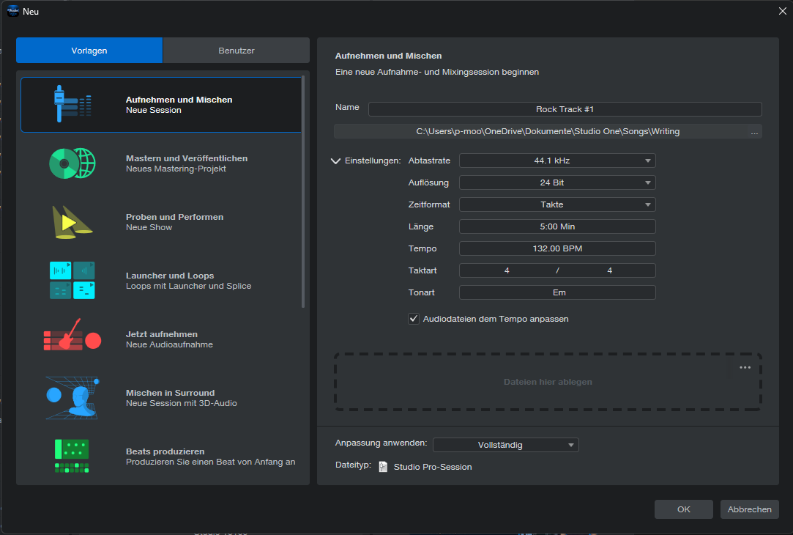
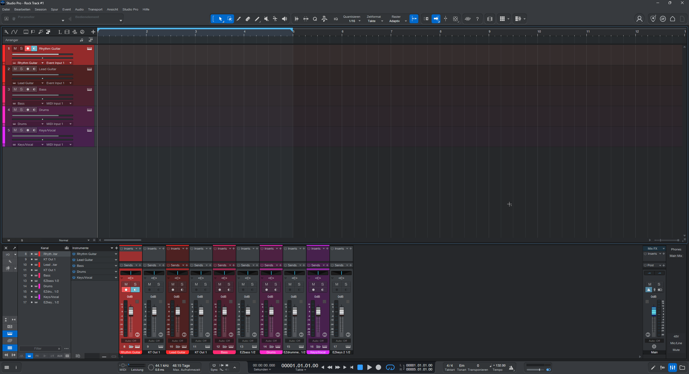
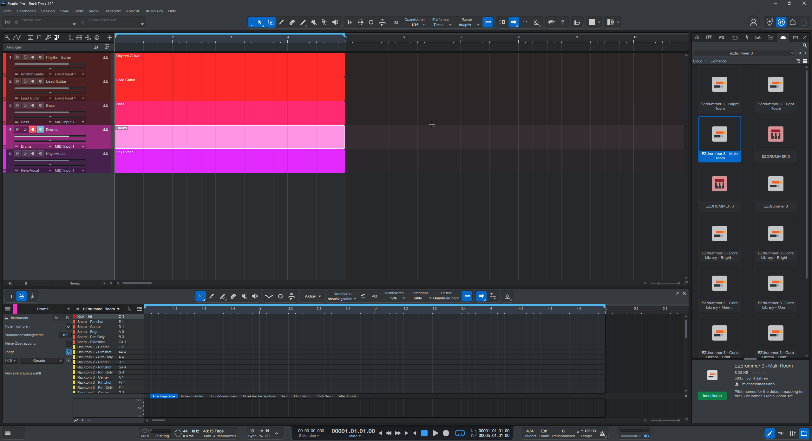
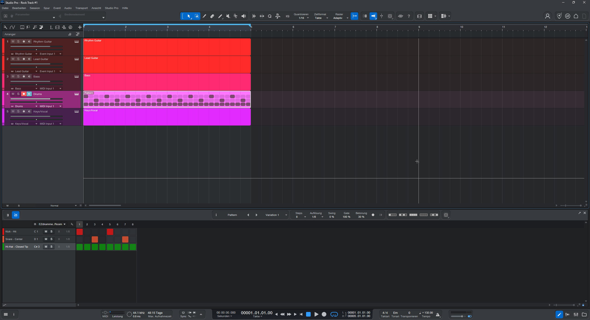
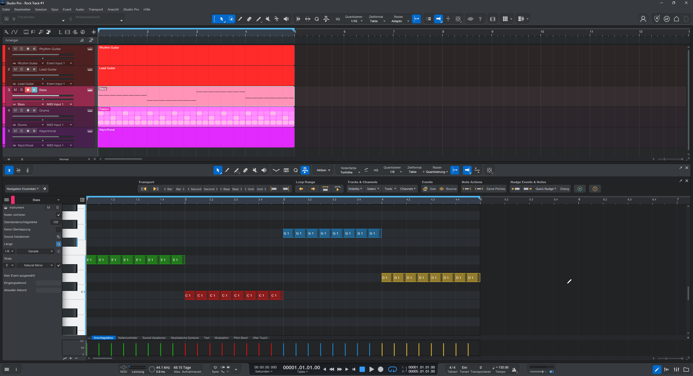
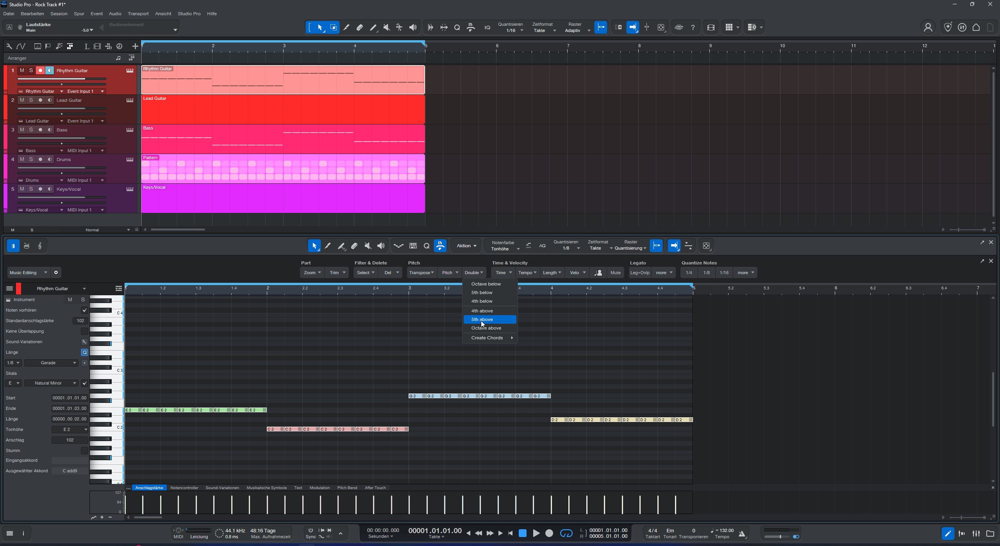
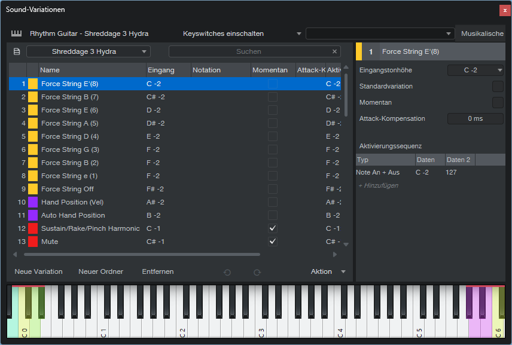
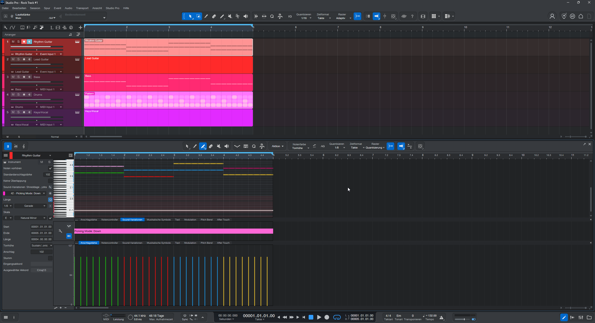
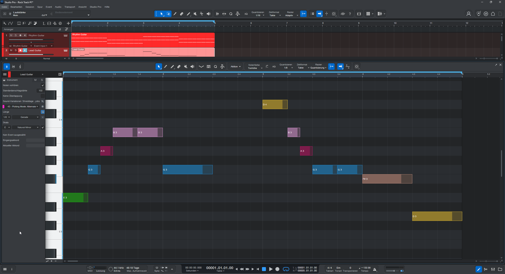
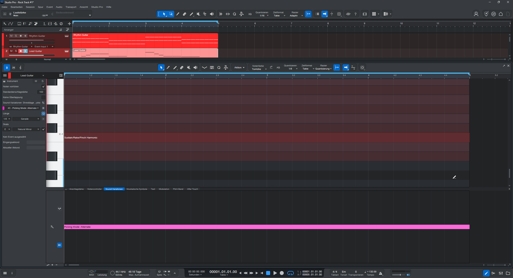

# Rocksong – Schritt 1: Produktion

Dieses Dokument beschreibt die vollständige Einrichtung und MIDI-/VST-Programmierung des Grundarrangements in Fender Studio Pro.

---

## 0. Projekteinstellungen

| Parameter | Wert | Funktion / Produktionshinweis |
| :--- | :--- | :--- |
| **DAW / Umgebung** | Fender Studio Pro | Session-Format (`.song`) |
| **Projektname** | `Einfacher Rocksong` | Zentrales Kompositions- und Aufnahmeprojekt |
| **Speicherpfad** | `C:\Users\p-moo\OneDrive\Dokumente\Studio One\Songs\Writing` | Standardordner für Songs |
| **Abtastrate** | 44,1 kHz | Standard für Streaming und Rockmischungen |
| **Auflösung** | 24 Bit | Professioneller Dynamikumfang (144 dB) |
| **Zeitformat** | Takte | Takt- und Beat-basiertes Arbeiten |
| **Länge** | 5:00 Min | Ausreichender Puffer für die Song-Entwicklung |
| **Tempo** | 132,00 BPM | Treibendes Rocktempo |
| **Taktart** | 4 / 4 | Gerader Rockrhythmus |
| **Tonart** | Em (E-Moll) | Legt die globale Tonleiterführung und Hilfslinien fest |
| **Audiodateien anpassen** | Aktiviert (Häkchen) | Automatische Zeitdehnung beim Audioimport |
| **Anpassung anwenden** | Vollständig | Volle Funktions- und Menüdarstellung in Studio Pro |
| **Dateityp** | Studio Pro-Projekt | Projektdatei im Studio-Pro-Format |



---

## 1. Audioeinstellungen

* **Abtastrate und Auflösung:** 44,1 kHz bei 24 Bit (48:15 Tage Aufnahmezeit-Puffer, 0,8 ms Latenz bei 44,1 kHz).
* **Transport und Raster:** 132,00 BPM im 4/4-Takt, globale Tonart Em (Transponierung: 0).
* **Schleifenbereich:** Takt 1.01 bis Takt 5.01 (`L 00001.01.01.00` bis `R 00005.01.01.00`) – geschlossene viertaktige Schleife.
* **Quantisierung:** 1/16 adaptiv im Hauptfenster, 1/8 quantisiert im MIDI-Editor.



---

## 2. Instrumente und Routing

| Spur-Nr. | Name | Klangerzeuger / Plugin | Klangbibliothek / Voreinstellung | Funktion im Arrangement |
| :---: | :--- | :--- | :--- | :--- |
| **1** | `Rhythm Guitar` | Native Instruments Kontakt 8 | Impact Soundworks Shreddage 3 Hydra (*Hydra 3.5 Lion Song*) | Powerchords und Rhythmusfundament (Achtel-Abschläge) |
| **2** | `Lead Guitar` | Native Instruments Kontakt 8 | Impact Soundworks Shreddage 3 Hydra (*Hydra 3.5 Lion Song*) | Melodieführung, Höhepunkt und Phrasierung |
| **3** | `Bass` | Toontrack EZbass | Standard Modern/Vintage Library | Tiefenfundament (Achtel auf dem Grundton) |
| **4** | `Drums` | Toontrack EZdrummer 3 | Standard Main Room Kit | Gerader Rock-Rückschlag im 4/4-Takt |
| **5** | `Keys/Vocal` / `Vocals` | Dreamtonics Synthesizer V Studio Pro | Liam AI (englische Gesangsdatenbank v201) | Leadgesang und zentrale Gesangsmelodie |

---

## 3. Schlagzeug

### Schlagzeugbelegung
* **Quelle:** PreSonus Exchange / Cloud Search (`ezdrummer 3`)
* **Paket:** `EZdrummer 3 - Main Room` (Tonhöhennamen von michaelmacasiano)
* **Funktion:** Eindeutige Bezeichnung aller Spielweisen im Editor statt allgemeiner Tastennummern



### Rhythmusmuster
* **Modus:** Studio-Pro-Schrittmuster (8 Schritte, 1/8-Auflösung pro Takt)
* **Groove-Parameter:** Swing: 0 % | Gate: 100 % | Akzent / Betonung: 30 %
* **Spurfilter:** Alle nicht verwendeten Zeilen (Toms, Becken, Sidesticks) für bessere Übersicht ausgeblendet
* **Belegung der 8 Schritte (Zählzeiten 1 bis 4+):**
  * `Kick - Hit` (C1): Schritte 1 und 5 (Zählzeiten 1 und 3)
  * `Snare - Center` (D1): Schritte 3 und 7 (Zählzeiten 2 und 4)
  * `Hi-Hat - Closed Tip` (C#3): Schritte 1–8 durchgehend (Zählzeiten 1 bis 4+)



---

## 4. Bass

### Spureinstellungen
* **Quantisierung:** 1/8 | Zeitformat: Takte | Raster: quantisiert
* **Tonleitersperre:** `E Natural Minor` im linken Inspektor aktiviert
* **Farbprofil:** Notenfarbe nach Tonhöhe (E = Grün, C = Rot, G = Blau, D = Gelb)
* **Anschlagstärke:** Einheitlich auf **102** festgelegt für ein druckvolles Tiefenfundament

### Viertaktige Akkordfolge
* **Takt 1 (Em):** `E1` – 8x Achtelnoten (durchgehend auf Zählzeiten 1 bis 4+)
* **Takt 2 (C):**  `C1` – 8x Achtelnoten (durchgehend auf Zählzeiten 1 bis 4+)
* **Takt 3 (G):**  `G1` – 8x Achtelnoten (durchgehend auf Zählzeiten 1 bis 4+)
* **Takt 4 (D):**  `D1` – 8x Achtelnoten (durchgehend auf Zählzeiten 1 bis 4+)



---

## 5. Rhythmusgitarre

### Akkorde und Frequenzstaffelung
* **Makroablauf in Studio Pro:** Grundtöne einzeichnen $\rightarrow$ `Aktion` $\rightarrow$ `Pitch` $\rightarrow$ `Double` $\rightarrow$ `5th above` (automatische Erzeugung von Powerchords)
* **Frequenztrennung:** Tiefe Suboktaven bereinigen, um Frequenzmaskierungen mit dem Bass (EZbass) im Bereich 40–100 Hz zu vermeiden
* **Notenbelegung (viertaktige Schleife):**
  * **Takt 1 (Em / E5):** `E2 + B2` (8x durchgehende Achtelnoten)
  * **Takt 2 (C / C5):** `C2 + G2` (8x durchgehende Achtelnoten)
  * **Takt 3 (G / G5):** `G2 + D3` (8x durchgehende Achtelnoten)
  * **Takt 4 (D / D5):** `D2 + A2` (8x durchgehende Achtelnoten)



### Spielweisen
* **Eigene Klangvariationen:** Eigenes Profil `Rhythm Guitar - Shreddage 3 Hydra` zur Steuerung aller Spieltechniken über Klartextbezeichnungen
* **Tastenumschaltung:** Durchgehende Steuernote auf `C-1` über alle vier Takte (Takt 1.01 bis 5.01) zur dauerhaften Aktivierung von `Sustain/Rake/Pinch Harmonic`
* **Anschlagstärkebereiche:**
  * **Anschlagstärke 1–119:** **Sustain** (aktiver Standardmodus für alle Rhythmusachtel)
  * **Anschlagstärke 120–126:** *Rake*
  * **Anschlagstärke 127:** *Pinch Harmonics*
* **Projekt-Anschlagstärke:** Einheitlich auf **102** festgelegt (oberer Sustain-Bereich mit maximalem Druck, ohne Nebengeräusche auszulösen)
* **Anschlagart:** Unterhalb der Notenmatrix ist über die gesamte Länge `42 - Picking Mode: Down` gesetzt. Dadurch werden ausschließlich Abschläge für den typischen kompakten Rock-/Punk-Klang verwendet.




> [!IMPORTANT]
> **ERINNERUNG: DOKUMENTATION UND DOWNLOAD**
> - **Projekt:** In das Astro-Dokumentations-Repository (`Creator & Studio Hub`) einbinden.
> - **Datei:** Benutzerdefinierte Klangvariation (`.keyswitch` beziehungsweise Studio-Pro-Preset) exportieren (`Sound-Variationen-Menü` $\rightarrow$ `Aktion` $\rightarrow$ `Exportieren`).
> - **Speicherort in der DAW:** `Dokumente\Studio One\Presets\User Presets\KeySwitches\`
> - **Einbindung in die Website:** Im Verzeichnis `src/assets/presets/` oder im statischen Ordner `public/downloads/` des Astro-Projekts ablegen & in der Preset-Dokumentation mit einer direkten Download-Schaltfläche verknüpfen.

---

## 6. Leadgitarre

### Melodie und Phrasierung
* **Tonaler Rahmen:** E-Moll diatonisch / pentatonisch im mittleren Register ($E3$ bis $D4$)
* **Periodischer Aufbau (Frage und Antwort):**
  * **Phrase 1 (Takt 1–2 / Vordersatz):** Beginnt auf dem Grundton $E3$, steigt schrittweise zur Quinte $B3$ auf und ruht auf der Quinte $G3$ über C-Dur. Die zweite Takthälfte von Takt 2 bleibt als Phrasenatmung vollständig frei.
  * **Phrase 2 (Takt 3–4 / Nachsatz):** Erreicht mit dem Oktavsprung auf $D4$ den absoluten Höhepunkt. Der anschließende Sekundschritt nach unten gleicht den Sprung aus.
  * **Abschluss (Takt 4):** Landung auf der Durterz $F\sharp 3$ (Leittonspannung über D-Dur) und abschließender Schritt nach $D3$, der die harmonische Bewegung zurück zum $E3$ von Takt 1 erzeugt.

### Notenmatrix der Leadmelodie
| Takt | Akkord | Zählzeit 1 | Zählzeit 2 | Zählzeit 2+ | Zählzeit 3 | Zählzeit 4 | Notenwert / Funktion |
| :---: | :---: | :---: | :---: | :---: | :---: | :---: | :--- |
| **1** | **Em** | **E3** | **G3** | **A3** | **B3** | **B3** | Viertel - Achtel - Achtel - Viertel - Viertel |
| **2** | **C** | **G3** | - | - | *Pause* | *Pause* | Halbe Note (Schlag 1–2) $\rightarrow$ 2 Beats Atmung |
| **3** | **G** | **D4** | **B3** | **A3** | **G3** | **G3** | Viertel (Höhepunkt) – Achtel – Achtel – Viertel – Viertel |
| **4** | **D** | **F#3** | - | - | **D3** | - | Halbe Note (Schlag 1–2) $\rightarrow$ Halbe Note (Schlag 3–4) |



### Spielweisen
* **Klangerzeuger / Voreinstellung:** Native Instruments Kontakt 8 $\rightarrow$ *Impact Soundworks Shreddage 3 Hydra* (`Hydra 3.5 Lion Song`)
* **Tastenumschaltung:** `C-1` (rastende Tastenumschaltung) ist als durchgehende Steuernote im Subbereich aktiviert, um den Sustain-Modus zu verwenden.
* **Klangvariationen (Anschlagart):** Für den gesamten viertaktigen Abschnitt ist `43 - Picking Mode: Alternate` aktiviert, damit einzelne Töne dynamischer klingen.
* **Anschlagstärke:** Einheitlich auf **102** gesetzt.



---

## 7. Gesang

### Stimmeinstellungen
* **Plugin-Instanz:** Dreamtonics Synthesizer V Studio Pro-Plugin (VST3)
* **Stimmdatenbank:** `Liam` (Synthesizer V AI – englisch, Version `201`, Voreinstellung `Default*`)
* **Stimmparameter:** Dynamische Parameter (Bright, Heavy, Rounded, Whispery, Soft, Hoarse) in neutraler Grundeinstellung
* **Raster und Tonart:** 132,00 BPM | 4/4 | 1/8-Raster | Tonleitersperre `E Natural Minor` aktiviert

### Text und Silbentrennung
* **Mehrzeilige Texteingabe (`Strg + L`):**
  ```text
  We start the fi- re to-night turn- ing the dark in- to light
  ```
* **Silbenaufteilung:** Bindestriche (`-`) steuern die Verteilung der Silben auf Achtel- und Viertelnoten; `to-night` wird als zusammenhängendes Wort auf eine halbe Note gelegt.


### Noten und Silben

| Takt | Zählzeit | Tonhöhe | Silbe | Lautschrift (ARPAbet) | Funktion / Phrasierung |
| :---: | :---: | :---: | :--- | :--- | :--- |
| **1** | **1** | **E3** | `We` | `[w iy]` | Tonika-Start / weicher Vokaleinsatz |
| **1** | **2** | **G3** | `start` | `[s t aa]` | Mollterz / perkussiver Zischlaut |
| **1** | **2+** | **A3** | `the` | `[dh]` | Quarte / kurzer Durchgangslaut |
| **1** | **3** | **B3** | `fi-` | `[f ay]` | Quinte / melodischer Zielton Phrase 1a |
| **1** | **4** | **B3** | `re` | `[er]` | Bekräftigung des Spitzentons |
| **2** | **1–2** | **G3** | `to-night` | `[t uw n ay t]` | Quinte über C-Dur; lange Halbe Note mit organischem Vibrato |
| **2** | **3–4** | - | *(Pause)* | - | **Phrasenatmung:** Raum für das Einatemgeräusch der KI-Stimme |
| **3** | **1** | **D4** | `turn-` | `[t er n]` | **Melodischer Höhepunkt:** Spitzenton des Stücks (kraftvoller Rockgesang) |
| **3** | **2** | **B3** | `ing` | `[ih n]` | Stufenweiser Abstieg (Ausgleichsbewegung) |
| **3** | **2+** | **A3** | `the` | `[dh]` | Sekundschritt abwärts |
| **3** | **3** | **G3** | `dark` | `[d aa r k]` | Akkord-Grundton G-Dur |
| **3** | **4** | **G3** | `in-` | `[ih n]` | Vorbereitung der Kadenz |
| **4** | **1–2** | **F#3** | `to` | `[t uw]` | Leitton über D-Dur (Halbe Note) |
| **4** | **3–4** | **D3** | `light` | `[l ay t]` | Halbe Note; Auflösung und Rückführung mit Vibrato-Ausklang |


### Gesang und Tonhöhen
* **Automatische Tonhöhenbearbeitung:** Synthesizer V modelliert kontinuierliche Tonhöhenkurven (grüne Vektorkurve) statt starrer Notenstufen.
* **Gebundene Töne und Portamento:** Realistische kleine Übergänge (Glissandi) bei Intervallsprüngen.
* **Vibrato-Modellierung:** Natürlich einsetzendes Vibrato auf den gehaltenen Tönen (`to-night`, `to`, `light`).