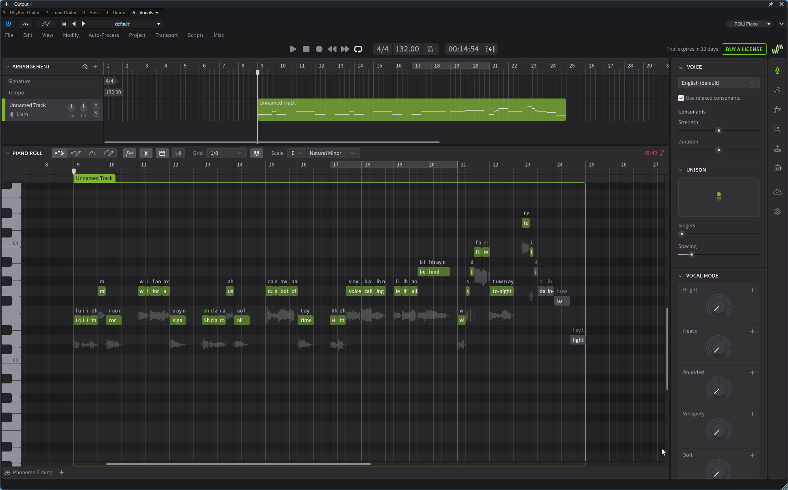

import DrumPattern from '../../../components/DrumPattern.astro';

Dieses Dokument beschreibt die MIDI- und VST-Programmierung der ersten 12 Takte (Strophe und Vor-Refrain). Das Ziel ist es, in der DAW gezielt Energie wegzunehmen und langsam wieder aufzubauen, um den Einstieg in das bestehende Refrain-Fundament massiv zu verstärken.

## 1. Arrangement-Struktur und Zeitachse

Um den Refrain musikalisch aufzuwerten, wird ihm ein 12-taktiger Aufbau vorangestellt. Die Energie wird in der Strophe stark reduziert (abgedämpfte Saiten, geringere Anschlagstärke) und im Vor-Refrain gezielt wieder aufgebaut, um sich im Refrain zu entladen.

| Songabschnitt | Takte | Harmonien (Akkorde) | Dynamik-Stufe | 
| :--- | :--- | :--- | :--- | 
| **Strophe** | 8 Takte | `Em - Em - C - C` (2x wiederholt) | 🟦 Niedrig (Zurückhaltend) | 
| **Vor-Refrain** | 4 Takte | `C - C - D - D` (1x) | 🟦🟦 Mittel (Steigend) | 
| *(Refrain)* | *8 Takte* | `Em - C - G - D` *(aus Schritt 1)* | 🟦🟦🟦🟦 Hoch (Explosion) | 

## 2. DAW-Vorbereitung und Projektanpassung

Da wir nach der „Hook-First“-Methode arbeiten und unser Refrain aus Schritt 1 bereits auf den ersten Takten liegt, müssen wir im Projektraum zunächst Platz für die neuen Abschnitte schaffen. 

* **Blöcke verschieben:** Markiere alle MIDI-Blöcke (Drums, Bass, Gitarren, Gesang) des Refrains aus Schritt 1 und verschiebe sie nach hinten auf **Takt 21**.

* **Die neue globale Zeitachse:**

  * **Takt 1 bis 8:** Intro *(Instrumental)*

  * **Takt 9 bis 16:** Strophe

  * **Takt 17 bis 20:** Vor-Refrain

  * **Takt 21 bis 28:** Refrain *(Bestehendes Material)*


## 3. Schlagzeug (Spur 4: EZdrummer 3)

### Strophe (Takt 9–16)

* **Grundrhythmus:** Das Muster aus dem Refrain (Kick auf 1 und 3, Snare auf 2 und 4, Achtel-Hi-Hat) wird 1:1 kopiert.

* **Anschlagstärke:** Die Energie wird deutlich reduziert. Alle Snare- und Hi-Hat-Noten werden markiert und die Anschlagstärke wird auf ca. **70–75** gesenkt. Die Bassdrum bleibt bei ca. **90**, um das Fundament zu sichern.

* **Ergebnis:** Der Rhythmus bleibt stabil, wirkt aber deutlich zurückhaltender und lässt Raum für den Gesang.

<DrumPattern
  interactive={false}
  showVelocity={true}
  patternData={[
    { name: 'Kick - Hit', note: 'C1', color: '#f87171', activeSteps: [0, 4], velocities: [90, 0, 0, 0, 90, 0, 0, 0] },
    { name: 'Snare - Center', note: 'D1', color: '#fbbf24', activeSteps: [2, 6], velocities: [0, 0, 75, 0, 0, 0, 75, 0] },
    { name: 'Hi-Hat - Closed Tip', note: 'A#-1', color: '#4ade80', activeSteps: [0, 1, 2, 3, 4, 5, 6, 7], velocities: [75, 75, 75, 75, 75, 75, 75, 75] }
  ]}
/>

### Vor-Refrain (Takt 17–20)

#### Takt 17–18

Identisch zur Strophe. Das Pattern wird über beide Takte wiederholt.

<DrumPattern
  interactive={false}
  showVelocity={true}
  patternData={[
    { name: 'Kick - Hit', note: 'C1', color: '#f87171', activeSteps: [0, 4], velocities: [90, 0, 0, 0, 90, 0, 0, 0] },
    { name: 'Snare - Center', note: 'D1', color: '#fbbf24', activeSteps: [2, 6], velocities: [0, 0, 75, 0, 0, 0, 75, 0] },
    { name: 'Hi-Hat - Closed Tip', note: 'A#-1', color: '#4ade80', activeSteps: [0, 1, 2, 3, 4, 5, 6, 7], velocities: [75, 75, 75, 75, 75, 75, 75, 75] }
  ]}
/>

#### Takt 19–20: Build-up

Kick und Snare spielen durchgehende Achtelnoten. Die Velocity steigt über beide Takte linear von 70 auf 127 an, um den Song kraftvoll in den Refrain (Takt 21) zu schieben.

<DrumPattern
  steps={16}
  interactive={false}
  showVelocity={true}
  patternData={[
    { name: 'Kick - Hit', note: 'C1', color: '#f87171', activeSteps: [0, 1, 2, 3, 4, 5, 6, 7, 8, 9, 10, 11, 12, 13, 14, 15], velocities: [70, 74, 78, 82, 86, 90, 94, 98, 102, 106, 110, 114, 118, 121, 124, 127] },
    { name: 'Snare - Center', note: 'D1', color: '#fbbf24', activeSteps: [0, 1, 2, 3, 4, 5, 6, 7, 8, 9, 10, 11, 12, 13, 14, 15], velocities: [70, 74, 78, 82, 86, 90, 94, 98, 102, 106, 110, 114, 118, 121, 124, 127] }
  ]}
/>

## 4. Bass (Spur 3: EZbass)

### Strophe (Takt 9–16)

* Der Bass spielt durchgehende Achtelnoten auf dem Grundton, passend zum verlangsamten harmonischen Rhythmus.

* **Anschlagstärke:** Leicht reduziert (ca. **85–90**) für ein zurückhaltenderes Fundament.

* **Töne:**

  * Takt 9–10: `E1` (16x Achtel)

  * Takt 11–12: `C1` (16x Achtel)

  * Takt 13–14: `E1` (16x Achtel)

  * Takt 15–16: `C1` (16x Achtel)

### Vor-Refrain (Takt 17–20)

* **Anschlagstärke:** Steigt wieder auf das Ausgangsniveau von **102**.

* **Töne:**

  * Takt 17–18: `C1` (16x Achtel)

  * Takt 19–20: `D1` (16x Achtel)

## 5. Rhythmusgitarre (Spur 1: Shreddage 3 Hydra)

### Strophe (Takt 9–16)

* **Akkorde:** Wie beim Bass verlangsamt sich der Wechsel (`E5 - E5 - C5 - C5`).

* **Spielweise (Abgedämpft):** Im Sub-Bereich des MIDI-Editors wird der Steuerton auf **`C#-1` (Mute)** geändert. Dadurch spielt die Shreddage 3 Hydra perkussive, abgedämpfte Powerchords (Palm Muting).

* **Anschlagart:** `42 - Picking Mode: Down` (reine Abschläge) bleibt über die gesamte Dauer aktiv.

### Vor-Refrain (Takt 17–20)

* **Akkorde:** `C5 - C5 - D5 - D5` (jeweils 16x Achtel).

* **Spielweise (Offen):** Der Steuerton wechselt auf **`C-1` (Sustain)**. Die Dämpfung wird aufgehoben und die Gitarre baut die volle harmonische Breite auf.

## 6. Leadgitarre (Spur 2: Shreddage 3 Hydra)

Die Leadgitarre (Spur 2) bleibt von Takt 1 bis 20 (Intro, Strophe und Vor-Refrain) **vollständig stumm** (leerer MIDI-Block). Dieser bewusste Verzicht schafft maximalen Raum für den Text und sorgt dafür, dass ihr leuchtender Einsatz ab Takt 21 (Refrain) mit enormer Wucht und emotionaler Wirkung wahrgenommen wird.

## 7. Gesang (Spur 5: Synthesizer V – Liam AI)

In der Strophe fungiert der Gesang als Geschichtenerzähler. Die Melodie liegt tief und rhythmisch eng am Beat. Im Vor-Refrain weiten sich die Notenwerte, und die Tonhöhe steigt stufenweise an, um den Höhepunkt des Refrains (das hohe `D4`) unüberhörbar vorzubereiten. 

* **Melodieführung:** Sprechgesang-Charakter (ausschließlich `E3` und `G3`).

### Text (Multi-Lyric Input)
```text
Look- ing in the mir- ror wait- ing for a sign Sha- dows a- round us all run- ning out of time Hear the voices call ing leave it all be- hind We start the fi- re to-night turn- ing the dark in- to light
```
*(Anmerkung: "We start the fire..." ist der nahtlose Übergang in den Refrain ab Takt 21).*

### Rhythmik und Notenmatrix

#### Strophe (Takt 8 bis 15)
Der Gesang greift dem Formteil als Auftakt leicht vor und startet bereits in Takt 8.

| Takt | Zählzeit | Tonhöhe | Textsilbe | Notenwert / Rhythmus | 
| :--- | :--- | :--- | :--- | :--- | 
| **8** | **1** | **E3** | `Look-` | Viertelnote | 
| **8** | **2** | **E3** | `ing` | Achtelnote | 
| **8** | **2+** | **E3** | `in` | Achtelnote (Off-Beat) | 
| **8** | **3** | **E3** | `the` | Viertelnote | 
| **8** | **4** | **G3** | `mir-` | Viertelnote (Aufwärtsbewegung) | 
| **9** | **1** | **E3** | `ror` | Halbe Note (Klingt aus) | 
| **10** | **1** | **E3** | `wait-` | Viertelnote | 
| **10** | **2** | **E3** | `ing` | Achtelnote | 
| **10** | **2+** | **E3** | `for` | Punktierte Viertelnote (Viertel + Achtel) | 
| **10** | **4** | **E3** | `a` | Viertelnote | 
| **11** | **1** | **E3** | `sign` | Halbe Note (Klingt aus) | 
| **12** | **1** | **E3** | `Sha-` | Viertelnote | 
| **12** | **2** | **E3** | `dows` | Achtelnote | 
| **12** | **2+** | **E3** | `a-` | Achtelnote (Off-Beat) | 
| **12** | **3** | **E3** | `round` | Viertelnote | 
| **12** | **4** | **G3** | `us` | Viertelnote | 
| **13** | **1** | **E3** | `all` | Halbe Note (Klingt aus) | 
| **14** | **1** | **E3** | `run-` | Viertelnote | 
| **14** | **2** | **E3** | `ning` | Achtelnote | 
| **14** | **2+** | **E3** | `out` | Punktierte Viertelnote (Viertel + Achtel) | 
| **14** | **4** | **E3** | `of` | Viertelnote | 
| **15** | **1** | **E3** | `time` | Halbe Note (Klingt aus) | 

#### Vor-Refrain (Takt 16 bis 20)

| Takt | Zählzeit | Tonhöhe | Textsilbe | Funktion / Rhythmus-Notiz | 
| :--- | :--- | :--- | :--- | :--- | 
| **16** | **1** | **E3** | `Hear` | Viertelnote auf der Eins | 
| **16** | **2** | **E3** | `the` | Viertelnote | 
| **16** | **3** | **G3** | `voi-` | Viertelnote (Steigende Linie) | 
| **16** | **4** | **G3** | `ces` | Viertelnote | 
| **17** | **1** | **G3** | `call-` | Punktierte Viertelnote | 
| **17** | **2+** | **G3** | `ing` | Punktierte Viertelnote (Synkope auf Off-Beat) | 
| **18** | **1** | **E3** | `leave` | Viertelnote | 
| **18** | **2** | **E3** | `it` | Viertelnote | 
| **18** | **3** | **E3** | `all` | Viertelnote | 
| **19** | **3** | **B3** | `be-` | Viertelnote (Extremer Leitton-Sprung) | 
| **19** | **4** | **B3** | `hind` | Halbe Note (Klingt bis Zählzeit 2 in Takt 20) | 
| **20** | *(Pause)* | \- | \- | KI atmet auf Schlag 3+4, baut maximale Spannung auf | 


  