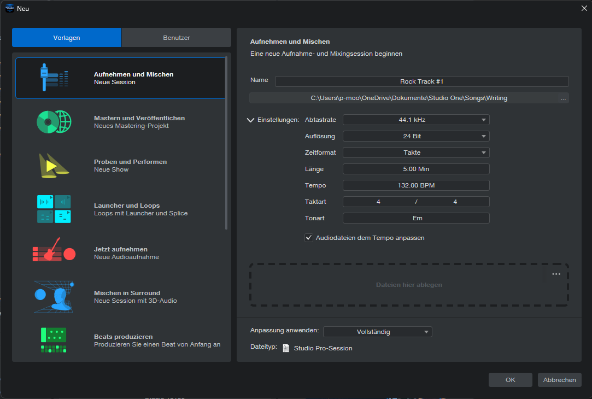
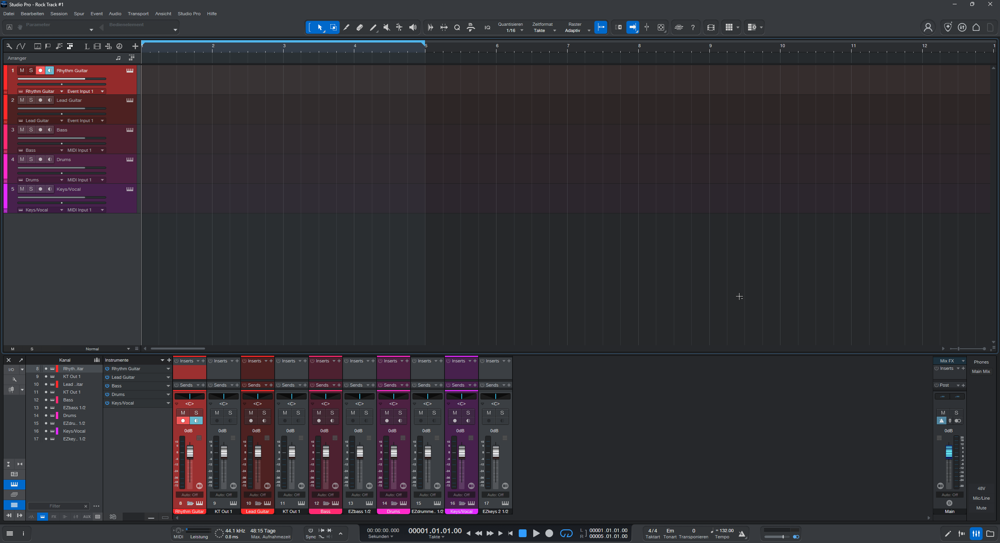
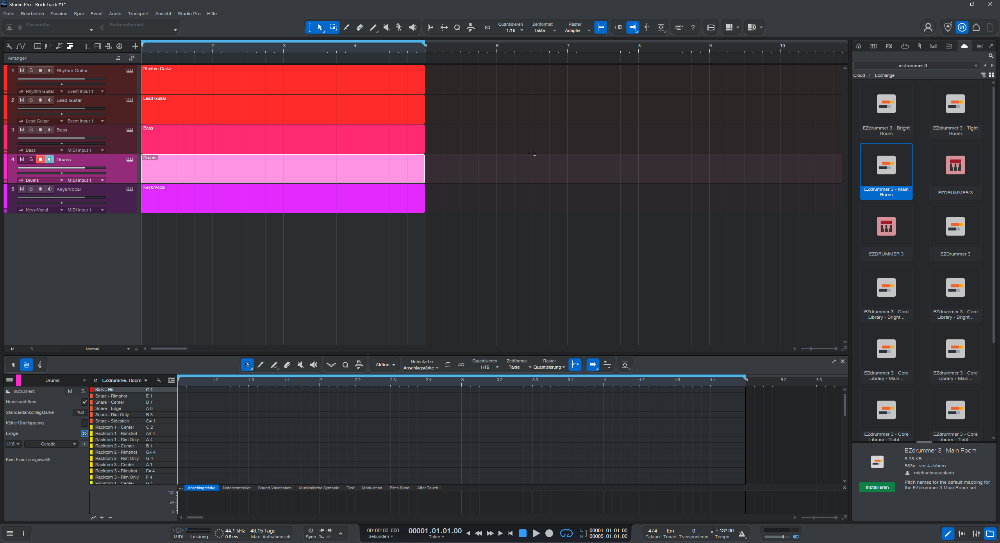
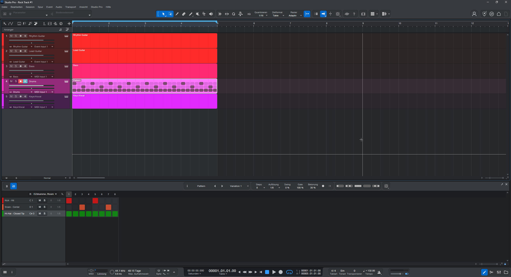
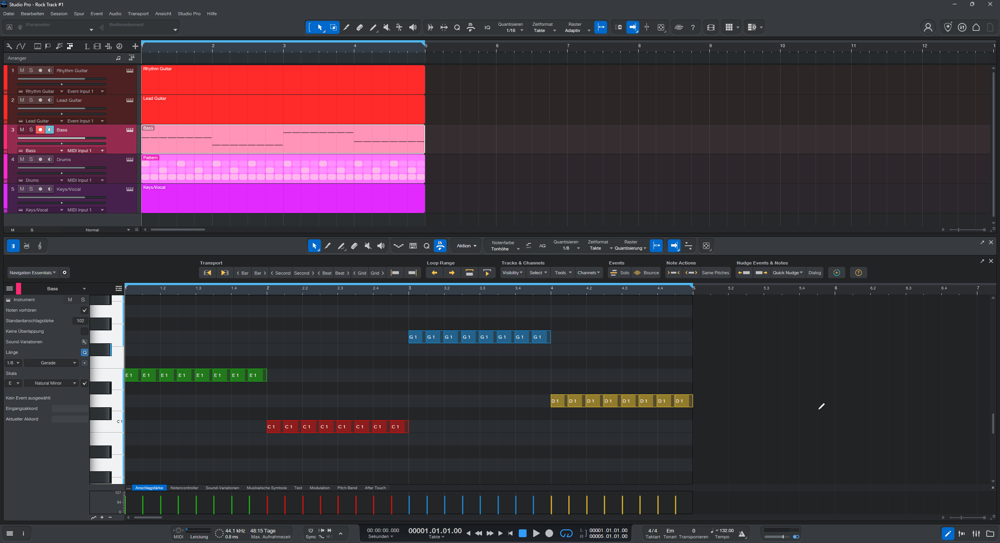
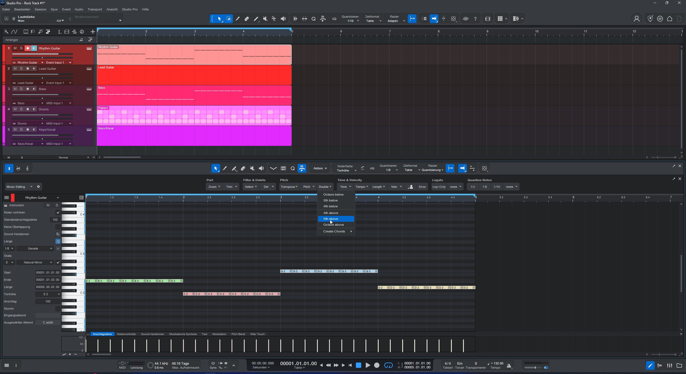
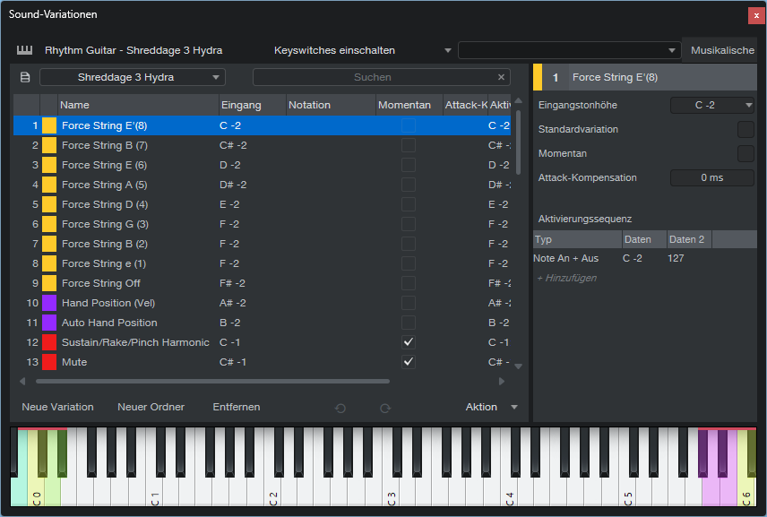
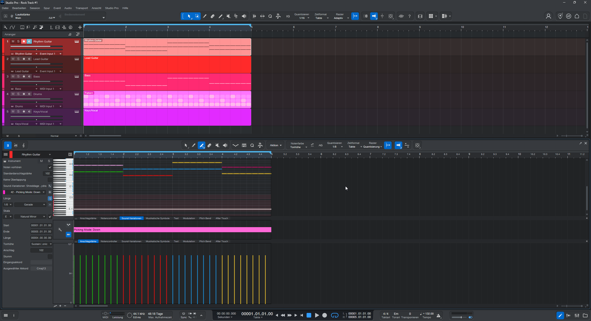
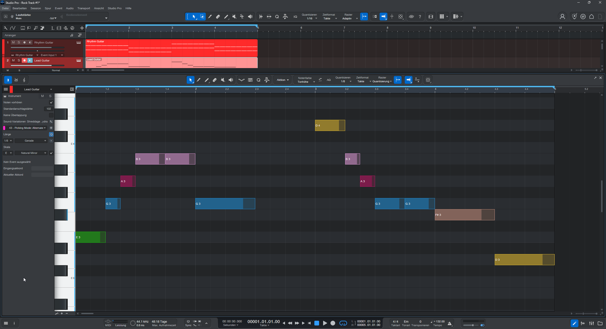
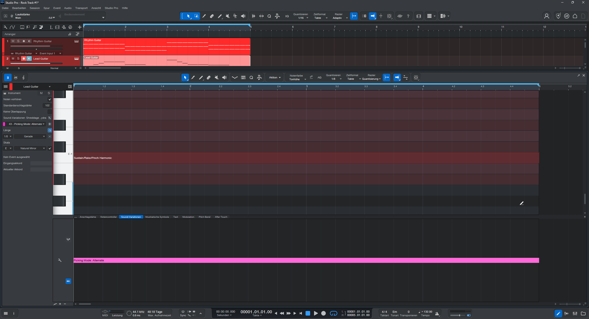

# Basic Rock Track - Schritt 1: DAW Produktion & Setup

Dieses Dokument protokolliert die vollständige Einrichtung und MIDI-/VST-Programmierung des Basis-Arrangements in Fender Studio Pro.

---

## 0. DAW Session Setup

| Parameter | Wert | Funktion / Produktionsnotiz |
| :--- | :--- | :--- |
| **DAW / Umgebung** | Fender Studio Pro | Session-Format (`.song`) |
| **Projektname** | `Basic Rock Track` | Zentrales Schreib- und Tracking-Projekt |
| **Speicherpfad** | `C:\Users\p-moo\OneDrive\Dokumente\Studio One\Songs\Writing` | Standard-Song-Verzeichnis |
| **Abtastrate** | 44.1 kHz | Standard-Abtastrate für Streaming & Rock-Mix |
| **Auflösung** | 24 Bit | Professioneller Dynamikumfang (144 dB) |
| **Zeitformat** | Takte | Takt- und Beat-basiertes Arbeiten |
| **Länge** | 5:00 Min | Ausreichender Puffer für die Song-Entwicklung |
| **Tempo** | 132.00 BPM | Treibendes Rock-Tempo |
| **Taktart** | 4 / 4 | Geradliniges Rock-Metrum |
| **Tonart** | Em (E-Moll) | Definiert globale Skalenführung & Hilfslinien |
| **Audiodateien anpassen** | Aktiviert (Häkchen) | Automatisches Time-Stretching bei Audio-Import |
| **Anpassung anwenden** | Vollständig | Volle Funktions- und Menüdarstellung in Studio Pro |
| **Dateityp** | Studio Pro-Session | Native Studio Pro Projektdatei |



---

## 1. Session-Spezifikationen & Audio-Engine

* **Samplingrate & Auflösung:** 44.1 kHz bei 24 Bit (48:15 Tage Aufnahmezeit-Puffer, 0.8 ms Latenz bei 44.1 kHz).
* **Transport & Grid:** 132.00 BPM im 4/4-Takt, globale Tonart Em (Transponieren: 0).
* **Loop-Bereich:** Takt 1.01 bis Takt 5.01 (`L 00001.01.01.00` bis `R 00005.01.01.00`) – geschlossener 4-Takt-Loop.
* **Arranger-Quantisierung:** 1/16 Adaptiv im Hauptfenster, 1/8 Quantisiert im MIDI-Editor.



---

## 2. VST-Instrumentenbelegung & Routing

| Track # | Name | Engine / Plugin | Sound-Library / Preset | Funktion im Arrangement |
| :---: | :--- | :--- | :--- | :--- |
| **1** | `Rhythm Guitar` | Native Instruments Kontakt 8 | Impact Soundworks Shreddage 3 Hydra (*Hydra 3.5 Lion Song*) | Powerchords & Rhythmus-Fundament (Downstroke-Achtel) |
| **2** | `Lead Guitar` | Native Instruments Kontakt 8 | Impact Soundworks Shreddage 3 Hydra (*Hydra 3.5 Lion Song*) | Melodieführung, Climax & Phrasierung |
| **3** | `Bass` | Toontrack EZbass | Standard Modern/Vintage Library | Low-End-Fundament (Grundton-Achtel) |
| **4** | `Drums` | Toontrack EZdrummer 3 | Standard Main Room Kit | Gerader 4/4-Rock-Backbeat |
| **5** | `Keys/Vocal` / `Vocals` | Dreamtonics Synthesizer V Studio Pro | Liam AI (English Vocal Database v201) | Lead Vocals & Hookline |

---

## 3. Drums: Pattern-Setup & PreSonus Exchange Integration

### Drum Map & Pitch Names
* **Quelle:** PreSonus Exchange / Cloud Search (`ezdrummer 3`)
* **Paket:** `EZdrummer 3 - Main Room` (Pitch Names by michaelmacasiano)
* **Funktion:** Eindeutige Benennung aller Artikulationen im Editor anstelle von generischen Tastennummern



### Pattern-Editor Konfiguration
* **Modus:** Studio Pro Step-Pattern (8 Steps, 1/8-Auflösung pro Takt)
* **Groove-Parameter:** Swing: 0 % | Gate: 100 % | Akzent / Betonung: 30 %
* **Spur-Filter:** Alle ungenutzten Zeilen (Toms, Cymbals, Sidesticks) ausgeblendet für maximale Übersicht
* **8-Step-Belegung (Zählzeiten 1 bis 4+):**
  * `Kick - Hit` (C1): Steps 1, 5 (Zählzeiten 1, 3)
  * `Snare - Center` (D1): Steps 3, 7 (Zählzeiten 2, 4)
  * `Hi-Hat - Closed Tip` (C#3): Steps 1–8 durchgehend (Zählzeiten 1 bis 4+)



---

## 4. Bass: EZbass MIDI-Programmierung

### Spur-Parameter & Editor-Konfiguration
* **Quantisierung:** 1/8 | Zeitformat: Takte | Raster: Quantisierung
* **Skalensperre:** `E Natural Minor` aktiv im linken Inspektor
* **Farbprofil:** Notenfarbe nach Tonhöhe (E = Grün, C = Rot, G = Blau, D = Gelb)
* **Velocity:** Einheitlich fest auf **102** für ein unnachgiebiges Low-End

### Harmonische Belegung (4-Takt-Loop)
* **Takt 1 (Em):** `E1` – 8x Achtelnoten (durchgehend auf Zählzeiten 1 bis 4+)
* **Takt 2 (C):**  `C1` – 8x Achtelnoten (durchgehend auf Zählzeiten 1 bis 4+)
* **Takt 3 (G):**  `G1` – 8x Achtelnoten (durchgehend auf Zählzeiten 1 bis 4+)
* **Takt 4 (D):**  `D1` – 8x Achtelnoten (durchgehend auf Zählzeiten 1 bis 4+)



---

## 5. Rhythmusgitarre: Shreddage 3 Hydra & Custom Sound Variations

### Akkord-Generierung & Frequenzstaffelung (Voicing)
* **Macro-Workflow in Studio Pro:** Grundtöne eingezeichnet $\rightarrow$ `Aktion` $\rightarrow$ `Pitch` $\rightarrow$ `Double` $\rightarrow$ `5th above` (automatische Powerchord-Erstellung)
* **Frequenz-Separation:** Bereinigung der tiefen Sub-Oktaven zur Vermeidung von Frequenzmaskierungen mit dem Bass (EZbass) im Bereich 40–100 Hz
* **Notenbelegung (4-Takt-Loop):**
  * **Takt 1 (Em / E5):** `E2 + B2` (8x durchgehende Achtelnoten)
  * **Takt 2 (C / C5):** `C2 + G2` (8x durchgehende Achtelnoten)
  * **Takt 3 (G / G5):** `G2 + D3` (8x durchgehende Achtelnoten)
  * **Takt 4 (D / D5):** `D2 + A2` (8x durchgehende Achtelnoten)



### Shreddage 3 Hydra Artikulationen & Custom Sound Variations
* **Custom Sound Variations:** Eigenes Profil `Rhythm Guitar - Shreddage 3 Hydra` zur Klartext-Steuerung aller Spieltechniken
* **Keyswitch-Verriegelung:** Durchgehende Steuernote auf `C-1` über alle 4 Takte (Takt 1.01 bis 5.01) zur dauerhaften Aktivierung von `Sustain/Rake/Pinch Harmonic`
* **Velocity-Layering:**
  * **Velocity 1–119:** **Sustain** (aktiver Standard-Modus für alle Rhythmus-Achtel)
  * **Velocity 120–126:** *Rake*
  * **Velocity 127:** *Pinch Harmonics*
* **Projekt-Velocity:** Einheitlich auf **102** fixiert (oberer Sustain-Bereich mit maximalem Punch, ohne Nebengeräusche auszulösen)
* **Picking Mode:** Unterhalb der Notenmatrix ist über die gesamte Länge `42 - Picking Mode: Down` gesetzt. Dies erzwingt 100 % reine Downstrokes (Abschläge) für die typische Rock-/Punk-Kompaktheit




> [!IMPORTANT]
> **REMINDER: ASTRO-DOKUMENTATION & DOWNLOAD-LINK**
> - **Projekt:** Einbindung in das Astro-Dokumentations-Repository (`Creator & Studio Hub`).
> - **Datei:** Benutzerdefiniertes Sound-Variation-Preset (`.keyswitch` bzw. Studio Pro Preset) exportieren (`Sound-Variationen-Menü` $\rightarrow$ `Aktion` $\rightarrow$ `Exportieren`).
> - **Speicherort DAW:** `Dokumente\Studio One\Presets\User Presets\KeySwitches\`
> - **Web-Integration:** Ablage unter `src/assets/presets/` oder im statischen `public/downloads/`-Verzeichnis des Astro-Projekts mit direktem Download-Button in der Preset-Dokumentation.

---

## 6. Leadgitarre: Melodieführung, Climax & Phrasierung

### Melodische Architektur & Stimmführung
* **Tonaler Rahmen:** E-Moll Diatonik / Pentatonik im mittleren Register ($E3$ bis $D4$)
* **Periodischer Aufbau (Question & Answer):**
  * **Phrase 1 (Takt 1–2 / Antecedent):** Startet auf Grundton $E3$, steigt stufenweise zur Quinte $B3$ auf und ruht auf der Quinte $G3$ über C-Dur. Takthälfte 2 von Takt 2 bleibt als Phrasenatmung komplett frei
  * **Phrase 2 (Takt 3–4 / Consequent):** Erreicht mit dem Oktavsprung auf $D4$ den absoluten Höhepunkt (**The Climax**). Der anschließende Sekundabstieg fängt den Sprung nach dem Gap-Fill-Prinzip sauber ab
  * **Abschluss (Takt 4):** Landung auf der Dur-Terz $F\sharp 3$ (Leittonspannung über D-Dur) und abschließender Schritt nach $D3$, der die harmonische Gravitation zurück zum $E3$ von Takt 1 erzeugt

### Noten-Matrix (Lead-Melodie)
| Takt | Akkord | Zählzeit 1 | Zählzeit 2 | Zählzeit 2+ | Zählzeit 3 | Zählzeit 4 | Notenwert / Funktion |
| :---: | :---: | :---: | :---: | :---: | :---: | :---: | :--- |
| **1** | **Em** | **E3** | **G3** | **A3** | **B3** | **B3** | Viertel - Achtel - Achtel - Viertel - Viertel |
| **2** | **C** | **G3** | - | - | *Pause* | *Pause* | Halbe Note (Schlag 1–2) $\rightarrow$ 2 Beats Atmung |
| **3** | **G** | **D4** | **B3** | **A3** | **G3** | **G3** | Viertel (*Climax*) - Achtel - Achtel - Viertel - Viertel |
| **4** | **D** | **F#3** | - | - | **D3** | - | Halbe Note (Schlag 1–2) $\rightarrow$ Halbe Note (Schlag 3–4) |



### Shreddage 3 Hydra Setup & Sound Variations
* **Engine / Preset:** Native Instruments Kontakt 8 $\rightarrow$ *Impact Soundworks Shreddage 3 Hydra* (`Hydra 3.5 Lion Song`)
* **Keyswitch-Verriegelung:** `C-1` (Latching Keyswitch) als durchgehende Steuernote im Sub-Bereich aktiv für sauberen Sustain-Modus
* **Sound Variations (Picking Mode):** Über den gesamten 4-Takt-Block ist `43 - Picking Mode: Alternate` aktiv gesetzt, um Einzeltönen dynamische Lebendigkeit zu verleihen
* **Velocity:** Einheitlich auf **102** eingezeichnet



---

## 7. Lead Vocals: Dreamtonics Synthesizer V AI (Voice: Liam)

### Engine, Voice Database & Projekt-Setup
* **Plugin-Instanz:** Dreamtonics Synthesizer V Studio Pro Plugin (VST3)
* **Voice Database:** `Liam` (Synthesizer V AI – English, Version `201`, Preset `Default*`)
* **Vocal Modes:** Dynamische Parameter (Bright, Heavy, Rounded, Whispery, Soft, Hoarse) auf neutraler Grundeinstellung
* **Raster & Tonalität:** 132.00 BPM | 4/4 | 1/8 Grid | Skalensperre `E Natural Minor` aktiv

### Text-Konzeption & Silbentrennung (Multi-Lyric Input)
* **Multi-Lyrics Dialog (`Strg + L`):**
  ```text
  We start the fi- re to-night turn- ing the dark in- to light
  ```
* **Silben-Logik:** Bindestriche (`-`) steuern die Silbenverteilung exakt auf die 1/8- und 1/4-Notenwerte; `to-night` wird als geschlossenes Wort auf die halbe Note gebunden


### Noten-, Silben- & Phonem-Matrix (13-Noten-Ablauf)

| Takt | Zählzeit | Tonhöhe | Silbe | Phoneme (ARPAbet) | Funktion / Phrasierung |
| :---: | :---: | :---: | :--- | :--- | :--- |
| **1** | **1** | **E3** | `We` | `[w iy]` | Tonika-Start / weicher Vokaleinsatz |
| **1** | **2** | **G3** | `start` | `[s t aa]` | Mollterz / perkussiver Zischlaut |
| **1** | **2+** | **A3** | `the` | `[dh]` | Quarte / kurzer Durchgangslaut |
| **1** | **3** | **B3** | `fi-` | `[f ay]` | Quinte / melodischer Zielton Phrase 1a |
| **1** | **4** | **B3** | `re` | `[er]` | Bekräftigung des Spitzentons |
| **2** | **1–2** | **G3** | `to-night` | `[t uw n ay t]` | Quinte über C-Dur; lange Halbe Note mit organischem Vibrato |
| **2** | **3–4** | - | *(Pause)* | - | **Phrasenatmung:** Raum für Einatemgeräusch der AI |
| **3** | **1** | **D4** | `turn-` | `[t er n]` | **The Climax:** Spitzenton des Tracks (Rock-Belting) |
| **3** | **2** | **B3** | `ing` | `[ih n]` | Stufenweiser Abstieg (*Gap-Fill*) |
| **3** | **2+** | **A3** | `the` | `[dh]` | Sekundschritt abwärts |
| **3** | **3** | **G3** | `dark` | `[d aa r k]` | Akkord-Grundton G-Dur |
| **3** | **4** | **G3** | `in-` | `[ih n]` | Vorbereitung der Kadenz |
| **4** | **1–2** | **F#3** | `to` | `[t uw]` | Leitton über D-Dur (Halbe Note) |
| **4** | **3–4** | **D3** | `light` | `[l ay t]` | Halbe Note; Auflösung & Rückführung mit Vibrato-Fahne |


### Neuronale Performance & Pitch-Kurven
* **Auto-Pitch-Processing:** Synthesizer V modelliert kontinuierliche Pitch-Kurven (grüne Vektorkurve) anstelle starrer Notenstufen.
* **Legato & Portamento:** Realistische Mikroschlenker (Glides) im Kehlkopfbereich bei Intervallsprüngen.
* **Vibrato-Modellierung:** Natürlich einschwingendes Vibrato auf den Haltetönen (`to-night`, `to`, `light`).